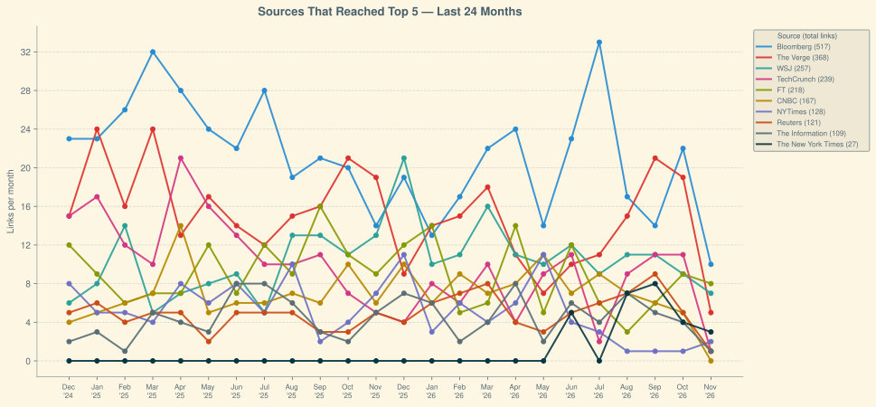

[The Ride Home](https://www.ridehome.info/show/techmeme-ride-home/) now has a proper web site and [RSS feed](https://rss.art19.com/techmeme-ridehome).

<section class="recent-shows">
  <h2>Most Recent Episode</h2>
  <h3>Tuesday, November 17, 2026 - Jensen Wants Back In!</h3>
  <ul>
    <li><a href="https://nvidianews.nvidia.com/news/nvidia-board-of-directors-establishes-national-security-and-export-control-oversight-committee">Nvidia’s board establishes a National Security and Export Control Oversight Committee to oversee national security policies, export control compliance, and more</a> (Nvidia Newsroom) &mdash; 🤖 <a href="categories/regulation-policy.html" class="ai-category">Regulation/Policy</a></li>
    <li><a href="https://www.ft.com/content/aeacbf89-5511-4d1c-81c2-b4c227bdfceb">Nvidia’s new export control committee will be chaired by ex-Goldman vice-chair Suzanne Nora Johnson, as Trump calls it a “great idea” and lawmakers prep a crackdown on AI chips reaching China</a> (FT) &mdash; 🤖 <a href="categories/regulation-policy.html" class="ai-category">Regulation/Policy</a></li>
    <li><a href="https://www.cnbc.com/2026/11/16/nvidia-ceo-jensen-huang.html">Nvidia’s board is not considering bringing Jensen Huang back as CEO and is focused on a Wachtell Lipton-led probe into whether his conduct compromised national security</a> (CNBC) &mdash; 🤖 <a href="categories/regulation-policy.html" class="ai-category">Regulation/Policy</a></li>
    <li><a href="https://www.nytimes.com/2026/11/16/technology/nvidia-jensen-madison-huang.html?unlocked_article_code=1.RFE.d0Ui.v_uJvV3zdxPR">Sources say: Jensen Huang’s daughter Madison remains in a senior Nvidia role, where she acted as his de facto chief of staff, raising questions for interim CEO Colette Kress</a> (The New York Times) &mdash; 🤖 <a href="categories/other-tech-news.html" class="ai-category">Other Tech News</a></li>
    <li><a href="https://www.wsj.com/tech/jensen-huang-statement-nvidia-ceo-9dedca36?st=1Tm7UU">Jensen Huang breaks silence, saying he is willing to return as Nvidia CEO if the board decides it is in the best interest of shareholders, employees, and the US</a> (WSJ) &mdash; 🤖 <a href="categories/other-tech-news.html" class="ai-category">Other Tech News</a></li>
    <li><a href="https://www.bloomberg.com/news/articles/2026-11-17/amazon-google-to-have-about-28-of-anthropic-stock-after-ipo">SEC filing: Amazon and Google are set to hold ~15% and ~14% of Anthropic’s outstanding capital stock, respectively, after its IPO and private placement</a> (Bloomberg) &mdash; 🤖 <a href="categories/ipo.html" class="ai-category">IPO</a></li>
    <li><a href="https://www.bloomberg.com/news/articles/2026-11-17/sequoia-greenoaks-lead-isomorphic-lab-s-5-billion-funding-round">Alphabet’s Isomorphic Labs raised a $5B Series C led by Sequoia and Greenoaks, after raising $2.1B in May and $600M in March 2025, to accelerate clinical trials</a> (Bloomberg) &mdash; 🤖 <a href="categories/ai-machine-learning.html" class="ai-category">AI/Machine Learning</a></li>
    <li><a href="https://www.bloomberg.com/news/articles/2026-11-17/apple-watch-siri-recap-review-ai-listening-adds-little-value">A week with Apple Watch’s Siri Recap and Live Rewind in beta: they can be inaccurate, lag Amazon Bee, Granola, and Otter, and rarely justify the privacy costs</a> (Bloomberg) &mdash; 🤖 <a href="categories/security-privacy.html" class="ai-category">Security/Privacy</a></li>
  </ul>
</section>

<nav class="recent-nav" aria-labelledby="recent-heading">
  <h2 id="recent-heading">Recent Content</h2>
  

    <a href="all-links-2026.html" class="nav-card">
      <h3>Show Links 2026</h3>
      
Daily tech news links from The Ride Home podcast

    </a>
    <a href="longreads-2026.html" class="nav-card">
      <h3>Longreads 2026</h3>
      
Weekend reading recommendations from Friday episodes

    </a>
    <a href="2025-wrapped.html" class="nav-card">
      <h3>2025 Wrapped</h3>
      
Year in review with top sources and topics

    </a>
  

</nav>

<!-- STATUS_SECTION -->

<section class="status-section" aria-labelledby="status-heading">
  <h2 id="status-heading">Current Status</h2>
  
Last Updated: <time datetime="2026-11-17T16:34:14-08:00">November 17, 2026 at 04:34 PM PST</time>

  

    

      <h3>Archive Size</h3>
      <ul class="status-list">
        <li>Show Links 13,456</li>
        <li>Weekend Longreads 1,809</li>
      </ul>
    

    

      <h3>Top Sources (Last 6 Months)</h3>
      <ol class="status-list">
        <li>Bloomberg (125 links)</li>
        <li>The Verge (83 links)</li>
        <li>WSJ (62 links)</li>
      </ol>
    

    

      <h3>Top Topics (Last 6 Months)</h3>
      <ol class="status-list">
        <li><a href="categories/ai-machine-learning.html" class="stat-label">AI/Machine Learning</a> (274 links)</li>
        <li><a href="categories/hardware-chips.html" class="stat-label">Hardware/Chips</a> (135 links)</li>
        <li><a href="categories/regulation-policy.html" class="stat-label">Regulation/Policy</a> (106 links)</li>
      </ol>
    

  

</section>
<!-- END_STATUS_SECTION -->

<section class="source-race-section" aria-labelledby="race-heading">
  <h2 id="race-heading">Source Trends</h2>
  
Sources that reached the top 5 in any month over the last 24 months. Hover over any dot to see the monthly count.

  <object type="image/svg+xml" data="assets/source-race.svg" style="width: 100%; display: block;">
    
  </object>
</section>

<nav class="archive-nav" aria-labelledby="archive-heading">
  <h2 id="archive-heading">Archive</h2>
  

    

      <h3>Show Links</h3>
      <ul>
        <li><a href="all-links-2025.html">2025</a></li>
        <li><a href="all-links-2024.html">2024</a></li>
        <li><a href="all-links-2023.html">2023</a></li>
        <li><a href="all-links-2022.html">2022</a></li>
        <li><a href="all-links-2021.html">2021</a></li>
        <li><a href="all-links-2020.html">2020</a></li>
        <li><a href="all-links-2019.html">2019</a></li>
        <li><a href="all-links-2018.html">2018</a></li>
      </ul>
    

    

      <h3>Longreads</h3>
      <ul>
        <li><a href="longreads-2025.html">2025</a></li>
        <li><a href="longreads-2024.html">2024</a></li>
        <li><a href="longreads-2023.html">2023</a></li>
        <li><a href="longreads-2022.html">2022</a></li>
        <li><a href="longreads-2021.html">2021</a></li>
        <li><a href="longreads-2020.html">2020</a></li>
        <li><a href="longreads-2019.html">2019</a></li>
        <li><a href="longreads-2018.html">2018</a></li>
        <li><a href="coronavirus-daily-briefing.html">COVID-19 Archive</a></li>
      </ul>
    

    

      <h3>Wrapped</h3>
      <ul>
        <li><a href="2024-wrapped.html">2024</a></li>
        <li><a href="2023-wrapped.html">2023</a></li>
        <li><a href="2022-wrapped.html">2022</a></li>
        <li><a href="2021-wrapped.html">2021</a></li>
        <li><a href="2020-wrapped.html">2020</a></li>
        <li><a href="2019-wrapped.html">2019</a></li>
        <li><a href="2018-wrapped.html">2018</a></li>
      </ul>
    

    

      <h3>Categories</h3>
      <ul>
        <li><a href="categories/ai-machine-learning.html">AI/Machine Learning</a></li>
        <li><a href="categories/automotive-mobility.html">Automotive/Mobility</a></li>
        <li><a href="categories/cloud-enterprise.html">Cloud/Enterprise</a></li>
        <li><a href="categories/crypto-blockchain.html">Crypto/Blockchain</a></li>
        <li><a href="categories/e-commerce-retail.html">E-commerce/Retail</a></li>
        <li><a href="categories/fintech.html">Fintech</a></li>
        <li><a href="categories/gaming.html">Gaming</a></li>
        <li><a href="categories/hardware-chips.html">Hardware/Chips</a></li>
        <li><a href="categories/ipo.html">Ipo</a></li>
        <li><a href="categories/other-tech-news.html">Other Tech News</a></li>
        <li><a href="categories/regulation-policy.html">Regulation/Policy</a></li>
        <li><a href="categories/security-privacy.html">Security/Privacy</a></li>
        <li><a href="categories/social-media.html">Social Media</a></li>
        <li><a href="categories/streaming-entertainment.html">Streaming/Entertainment</a></li>
      </ul>
    

  

</nav>

